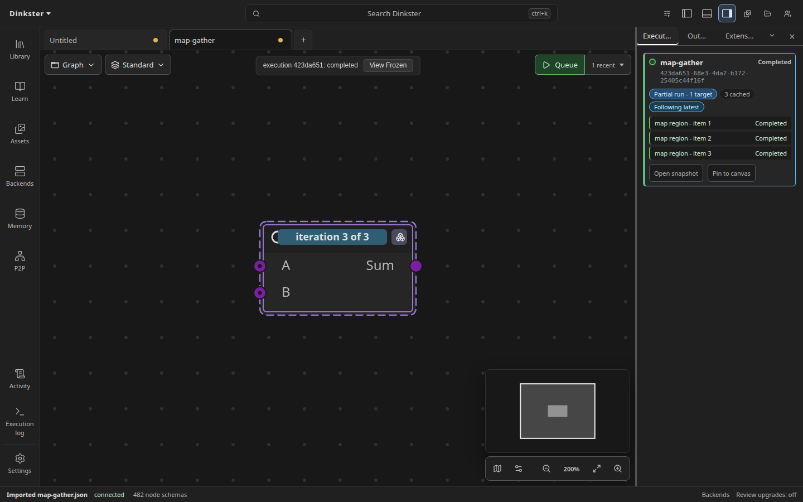

# ComfyUI Workflow Translation

The app imports ComfyUI LiteGraph documents through `importLitegraph` against
the selected backend's ordinary schema registry. It does not use compatibility
catalog snapshots, collapse matched node groups into native carriers, or build
an alias review cohort. Authored nodes and topology remain in the imported
document. Classes absent from the registry remain unresolved and are reported
as missing; a carrier catalog does not make them executable.
Subgraph inputs can attach to authored reroute junctions. Their port binding
identifies the schema authority while `viaReroute` identifies the actual input
attachment; downstream fan-out is derived from the retained links. Compilation
traces each occurrence's parent input without deleting reroutes or bypassing
their links. Widget promotion follows the downstream schema input, including
nested instances. Parent delivery suppression is occurrence-local and removes
the effective junction driver without changing a sibling instance.
Import asset lookup includes promoted ASSET filenames on subgraph instances
as well as definition defaults. Accepting a match updates only literals with
that filename in one undo step; sibling overrides and other defaults remain intact.
The drilled canvas draws the Inputs noodle into the actual junction dot;
retained fan-out noodles continue from that dot to their authored destinations.
Flattening and extraction preserve junction identity, geometry and fan-out.
Mixed direct and junction bindings preserve their authored delivery order.
Historical alias and group snapshots also supply no post-open replacement
rules, source schemas, or asset lookup authority. Successor-declared native
`replacements` decode into the normalized schema model. Core provides its
generic rule registry, planner, scanner, and atomic replacement command; no
alias-generated rules are registered. Native documents apply applicable
migrations on open as one undo step, including lossy plans. A dismissable
Problems notice lists upgraded nodes and warnings, with node navigation;
it clears on save or tab close and is never persisted. Upgraded nodes look
ordinary. The status bar's Review upgrades toggle opts out for subsequent
opens and enables migration badges, plan diagnostics and manual apply.
Schema-arrival diagnostics and legacy boolean normalization remain;
deprecation pointers alone do not authorize graph edits.
Count-bound output-family copies can upgrade an absent predecessor schema:
the rule must copy a stored literal count unchanged into the target count
input. The target schema admits the canonical ordered members; linked,
invalid or out-of-range counts refuse planning, and later count or endpoint
changes invalidate the plan. When present, the predecessor schema also
validates the source family and its count input. Input-family copies still
require the source template layout: a copy rule may declare
`sourceTemplate: {inputs: [all historical template-local IDs], memberPort?: "flat.port"}`
when the predecessor schema is absent. The full ordered list distinguishes
single-input members from grouped paths even if only one input is mapped.
`memberPort` explicitly identifies a flat-prefix port with member IDs and is
valid only for a single-input template. An available predecessor must agree
with this declaration; same-type migrations instead use the authored
historical template, not the current schema. Omitted declarations retain
schema-based planning. Copies preserve stored member order and controller
modes, and refuse application after the source node or incoming topology changes.
The native client ignores pack-level alias/group catalogs: they supply neither
registry entries nor extra carrier search terms. Native schema resolution uses
only exact registered node IDs; historical node alias metadata is not a lookup
path. Search terms remain presentation-only properties of the schema.
The importer also requires a supplied schema's ID to equal the requested class:
a custom resolver cannot rename a node by returning another class's schema.
Mismatched results are treated as missing, retaining authored widget values and
serialized socket names for diagnosis and refusing compilation when unresolved.
The importer accepts only the ordinary schema resolver and the optional
class/version widget upgrade table; there is no group-collapse or source-snapshot
predicate. Family members use the declared schema scope, with prefix members
assigned persisted identities in authored input order.
The core has no pack alias/group catalog parser or group-collapse command.
Schema aliases do not synthesize document migrations or positional output
rewrites. Opening a saved native document preserves its authored node and port
identities; invalid ports remain compile diagnostics rather than being guessed.
Historical SaveVideo carrier conversion and MiniMax carrier-catalog fixtures
are not import paths;
ordinary workflow fixtures preserve their authored class identities and remain
unresolved when those classes are absent from the selected registry.

Positional `widgets_values` consume one companion entry after a widget with
`control_after_generate`. The strings `fixed`, `increment`, `decrement` and
`randomize` select the controller mode; legacy booleans select `fixed` for
false and `randomize` for true. The companion is not the next input's value.
Older arrays without a companion still preserve the next numeric widget.
If a boolean could instead belong to the next BOOLEAN widget or an unresolved
dynamic construct, import refuses with `import.controller.ambiguousBoolean`.
An explicit string controller or a class/version widget upgrade resolves that
ambiguity; the importer never silently shifts a following boolean input.

The importer owns `COMFY_NODE_UPGRADES`, keyed first by the authored ComfyUI
class name and then by the exact version saved in the node's `properties.ver`.
SaveVideo version `0.3.68` three-value arrays retain their prefix, container
and codec while adding explicit automatic encoding and fallback codec choices
required by the current schema. Keyed values and already-expanded arrays stay
unchanged. A rule upgrades only saved widget values before positional decoding;
it cannot insert nodes, change class identities, or rewrite links. Missing or unmatched versions
use the ordinary import path. Root nodes and subgraph definitions use the same
table. These source versions are not the workflow format's `version` field.

Separately, a SaveVideo node without `properties.ver` can carry the recognized
three-widget layout: string filename prefix, supported container, supported codec.
When the served schema accepts those choices, import stores the codec explicitly
in both the container branch and fallback codec input, including automatic
encoding choices. It records `importer.versionlessWidgetLayout` on the imported
node and emits `import.widgets.versionlessLayout`; the original source stays
unchanged and no version is invented. Other versionless layouts use ordinary
decoding and retain its diagnostics. Compilation still requires stored choices.

Primitive producers inside imported subgraphs remain first-class value sources,
not runtime helper nodes. Native `valueSource` boundary bindings retain the
authored interface type independently of the stored literal. Proxy values and
controller modes are retained on each instance; a missing value uses the shared
definition's literal, while an explicit null remains null. Compilation reads
occurrence-local overrides without modifying the definition. A connected proxy
input takes precedence over the instance's stored literal. Each value source
can have only one input boundary slot; duplicate targets are rejected rather
than choosing a driver or literal by declaration order. Deleting the value
source removes its boundary slots in the same undoable transaction.

Source pills and their spec popovers resolve consumers across exported subgraph
outputs. Shared stored literals combine constraints across instances; separately
promoted owners remain independent in drilled views. Definition views combine
the reachable consumers, while uninstantiated definitions retain local specs.
This read-only presentation query also sees inactive structural-selector
candidates and works while unrelated nodes are incomplete. It never changes
stored values or serializes inferred widget constraints; pinning is explicit.

Promoted literal inputs use the same occurrence-specific constraints as their
source pills. Missing overrides display the source's stored value and mode;
explicit instance values and controller modes remain local, including when
viewing a nested instance. Editing a projected widget writes its outer owner.

Extraction moves selected value sources and their outgoing fan-out into the
new definition without a runtime producer. Existing authored output types are
retained; a source with no authored boundary type uses wildcard, never a type
guessed from its literal. Conflicting authored output types refuse extraction
atomically. Enclosing boundary bindings and stale-selection fingerprints follow
the moved source identity, and one undo restores the original graph.
Enclosing input boundaries follow the moved source into the new definition.
Nested instance values override the inner literal independently per occurrence;
an outer instance value wins over an inner one, and a connected driver wins
over either stored value. Native reopen and extraction undo/redo retain that
precedence without rewriting the shared definition's values.

Occurrence-local links can use a value-source output boundary directly or
through enclosing forwarding boundaries. The route retains the authored source
identity and type, terminates at the existing source, and remains scoped to its
occurrence through save/reopen and undo/redo. Input promotion still carries
values, not consuming links: a value source cannot be a local link target.

Flattening an occurrence with literal output bindings copies each retained
source once into the parent and remaps outgoing links and enclosing output
bindings to that fresh identity. Source values, declared specs and controllers
are retained, and sibling occurrences keep the shared definition unchanged.
Named nets cannot use a literal as their source; flattening refuses that
unrepresentable result atomically rather than inventing a runtime node.

Inside a definition, literal output bindings draw from the retained source pin
to the Outputs boundary. The Boundary panel displays the source title and ID;
Show selects and centers that source without changing the document. Input
promotion carries an override value, not an incoming wire to the source.

After-generate advancement follows the compiled literal owner instead of
changing its connected consumer widgets. Shared producer fan-out advances once;
promoted instance controls own their occurrence overrides and inherit missing
values and modes from the inner source. Declared source widget constraints take
precedence over consumer-derived constraints. Only executed consumers contribute
advancement. Completion preserves user edits, including edit-and-restore changes,
and skips controls whose live route, effective mode, or widget semantics changed.
Changing a controller mode and restoring it still invalidates pending advancement;
explicitly storing an unchanged effective mode does not. Source advancement uses
the ordinary undoable value-source command, without helper nodes.

Forced-input FLOATS sockets can carry a NUMBER presentation with floating-point
constraints. The decoder retains the FLOATS socket and scalar default, min and
step; it does not replace the runtime type with FLOAT or a primitive list.
Unforced FLOATS and list<FLOATS> do not accept this numeric presentation.

Native inputs may declare the boolean `socketless` presentation flag. True
omits only the incoming socket and its hit target, preserving the editor,
outgoing value tap, runtime type, default, positional slot and compile value.
Nested branches and family members retain the flag in their own scopes.
It does not change registry identity and cannot be combined with `forceInput`.

Subgraph boundaries can promote inputs from the selected native DynamicCombo
branch using their materialized input paths. The promoted widget inherits its
stored value; inputs from inactive branches remain unavailable.

Native save inputs keep `filename_prefix` as a STRING and append an optional
STRING `mount` with the closed widget descriptor `{"type":"MOUNT"}`. Null or
omitted mount uses the backend's snapshot default output mount; an explicit
mount remains a separate string, never a combined prefix/target value.
The importer keeps prefix strings intact; it does not wrap them in target
objects or infer a mount from a schema's prefix default.
Optionality and the null default belong to these save-node declarations, not
to the generic MOUNT descriptor, which can present other STRING inputs.
MOUNT defaults accept strings or null; other JSON shapes fall back to null.
Malformed string ids remain visible for validation rather than silently
selecting a different mount.
The input's `adjacentTo` names a different sibling input for presentation only.
The codec preserves declaration order, including positional widget slots, and
rejects empty, self-referencing, cyclic or missing sibling hints and extra MOUNT fields.
Visible widgets honor the hint horizontally beside the referenced sibling on
the same line in the same section, with independent editors and separated
input/value-output sockets on the outer borders in distinct vertical slots,
so connected wires stay visible outside the node. A shared line has a width
floor for both controls; a hidden or socket-only sibling leaves ordinary row order.
Nested branch and family hints resolve within their own materialized sibling
scope; they never attach to a different member or change declaration order.
The MOUNT editor uses the existing mount index, offers only ready writable
mounts and an explicit default-output choice, and commits only a mount string
or null. Missing saved mount ids remain visible as unavailable, not silently
replaced with the first writable mount. Prefix editing is independent.

Positional and keyed static COMBO widgets preserve strings, booleans, and
finite numbers exactly through import, editing, native save/reopen, and
compilation. Numeric 8 differs from string "8", and true differs from 1.
Display labels never rewrite stored values; unmatched values remain available
for ordinary validation. Dynamic branch and input-family keys remain strings,
and MULTI_COMBO retains its string-only option and value contract.

ComfyUI `Note` and `MarkdownNote` records translate directly to Dinkster's
frontend-only Note and Markdown Note kinds. Text, title, position, size, and
color remain visible and editable after import. The core LiteGraph translation
API emits corresponding note records for export callers; native app downloads
remain Dinkster workflow documents. Notes never enter the executable graph sent
to a backend. Reroutes remain document constructs and use the topology
translator.

Import reconstructs Autogrow members from every authored input slot, including
unlinked slots, before decoding positional or keyed widgets. It does not copy
families to another node type or insert helper nodes. The class/version upgrade
table changes widget values only; it is not a graph migration
or a family replacement mechanism.

ComfyUI-KJNodes `SetNode`/`GetNode` pairs and cg-use-everywhere resolved
connections import as native named nets and compile to the same executable
topology as explicit links. These Set/Get node types come from
ComfyUI-KJNodes; rgthree-comfy and ComfyUI-Custom-Scripts do not define them.
The importer requires the KJNodes single-input/single-output Set shape,
single-output Get shape, one unambiguous named Set source, valid slot-zero
wiring, and consistent serialized types. Missing sources or matches,
duplicates, malformed shapes, conflicting types, and cycles fail the whole
import with diagnostics. KJNodes names resolve inside each definition before
any subgraph inlining, so identically named nets in separate graphs never merge.

## LiteGraph subgraphs

Import indexes flat and recursively nested `definitions.subgraphs` catalogs,
then translates child definitions before their parents. UUID boundary identities,
instance references, positions, promoted values, and fan-out inputs survive.
Schema-v1 object links and v0.4 tuple links are accepted. Competing definition
links follow LiteGraph's load rule: prefer the inner input's serialized `link`,
otherwise retain the first delivery in document order.

For direct widget-backed input deliveries, the first widget in the boundary's
saved `linkIds` supplies the promoted type and default. Other raw deliveries,
including links absent from that list, remain fan-out targets; promotion does
not prune the authored graph. The original definitions remain in import metadata.
An unlisted delivery with a different declared type produces
`import.subgraphs.boundaryTypeConflict`, identifying the promoted and conflicting
links without rewriting their types, stored values or destinations.

Output boundaries trace reroute chains back to their unique producing port,
retaining the internal reroute vertices, links and positions. Dangling or cyclic
chains refuse import rather than guessing a source. Input boundaries through
reroutes retain their junction attachment and internal fan-out links.

Input boundaries attached to materialized native family members use the exact
elaborated member address, including grouped template input suffixes and nested
members beneath ordinary outer families. Only members retained in the node's
dynamic state resolve; absent members do not create ports or helper nodes.
Native save/reopen preserves these bindings. Flatten planning resolves concrete
member targets against the same retained node state and preserves their exact
endpoint addresses without allocating replacement family members.

Modern instance widget arrays follow promoted-input order without implicit
seed-controller entries, even when the instance socket array omits widget-only
inputs. Socket links keep their instance indices and resolve boundary identities
by their unique names rather than shifting across omitted inputs.
Unmatched or ambiguous sockets remain unresolved regardless of array length:
invalid inputs block compilation and invalid linked outputs report an import
error, without remapping them by display labels or ordinal positions in the flat
decoder.
Legacy `proxyWidgets` references promote matching
inner widgets; missing host values inherit the definition's saved values.
Unresolved widget state stays under `importer.subgraphWidgets` with a warning.
Repeated links from the same producer socket to one output boundary represent
one route. Distinct producer sockets or declared link types still refuse import
rather than choosing an output driver.

An authored definition and its nested instances remain real subgraphs whether
the current catalog lacks a node schema or exposes an incompatible port. Its
authored slot types provide a review-only interface and
`import.subgraphs.boundaryUnresolved` reports the limitation in Problems.
Unresolved dynamic input endpoints are also reported and their invalid links
are omitted. If a structural boundary cannot be represented without dropping
an endpoint, `import.subgraphs.boundaryUnsupported` refuses the import instead
of returning a flattened or lossy document. Cycles and malformed definitions
also refuse the import; preservation never invents a backend node alias. The boundary-forwarding cases in
[issue #397](https://github.com/Kosinkadink/Dinkster-Frontend/issues/397) remain separate.

The format reference is Comfy-Org/ComfyUI_frontend revision
`96f4a09a570d1bca4cd10c8407ed8e5c20a23875`. Browser coverage imports three
official nested workflows, drills through both boundaries, and saves/reopens
native documents. Fixture provenance is in
`packages/core/fixtures/workflows/official-subgraphs/README.md`.

## Generic Loops

Maintained ComfyUI `StartLoop` and `EndLoop` pairs import as explicit fold
regions. Simple, For, and List iteration preserve binding order, carried state,
first and last flags, accumulated scalar or output-list results, final-only
results, termination targets, nesting, and iteration cache policy. A loop with
no carried state remains a fold because ComfyUI executes iterations in order.
Heterogeneous `CreateList` values lower to positional tuples. Accumulating a
tuple gathers one whole tuple per iteration, yielding a list of tuples; only
execution-list outputs flatten. Tuple families declare exactly one input per
member, matching the backend schema contract.
Compatible lazy switches lower to Dinkster's native selector inside the region,
so each iteration executes only its selected branch.

The importer pairs boundaries from the authored topology and refuses the whole
import when pairing is ambiguous or malformed, a body escapes its End Loop, a
carry cannot keep one stable type, output cardinality is unknown, or topology
sugar prevents an exact rewrite. Linked `accumulate` controls are also refused:
Dinkster output roles are static, while changing `accumulate` at execution time
would change the output contract. Linked Simple or For range controls feed a
generated integer-range node, so upstream batch sizes and computed bounds remain
live inputs. Static `accumulate=false` uses a `last` output, which yields typed
absence for zero iterations. `cache_iterations=true` maps to `reuse`; false or
omitted maps to `rerun`.

Loop bodies containing a schema flagged `mayExpandGraph` refuse with
`import.loop.runtimeExpansionUnsupported`; derived subgraph schemas propagate
the flag from their descendants. Nested Start/End boundaries are consumed
before the enclosing body is checked. V3 flags exactly
`enable_expand=True`. V1 flags direct dict-literal expansion returns and the
enumerated core expanders at the pinned revision. Delegated, dynamic, and custom
V1 returns remain unclassified and rely on Dinkster's loud runtime refusal
before output.

The structural reference and CPU acceptance corpus are pinned to ComfyUI
`b5cc8830279eae909a59de030af1e50761c36751`. The corpus covers 23 openable
workflows, including empty, carried, lazy, output-list, nested, and repeated
cache cases.

### Conversion limits

| Source behavior | Imported behavior |
| --- | --- |
| A nested cache-enabled loop runs a non-idempotent outer probe with `outer_probe_calls=[1,2,2]` over two runs because `StartLoop` contributes a NaN fingerprint to one expanded occurrence's cache ancestry. | Dinkster keeps occurrence reuse and produces `outer_probe_calls=[1,2]`. The ComfyUI rerun is a cache-key artifact that contradicts its single-loop cache contract. Idempotent nodes retain identical outputs; non-idempotent nodes expose the execution-count difference. The importer does not suppress observations, gate conversion, or refuse this case. |



### Coverage report

`pnpm coverage:subgraphs` reads an ordinary captured Dinkster `/api/nodes`
payload using the native decoder. Invalid catalogs fail before the sweep.
The report separates retained subgraph definitions from missing schemas and
error diagnostics; missing families are blockers, not exclusions:

```sh
pnpm coverage:subgraphs --templates /path/to/workflow_templates \
  --nodes /path/to/native-nodes.json \
  --json-output coverage/subgraphs.json --markdown-output coverage/subgraphs.md
```

The template checkout must be clean. Its revision and the supplied catalog path
are recorded in report format `dinkster-comfy-subgraph-coverage/2`.
`definitions` means native definitions were retained,
`blocked` means no document was produced, and `not-needed` identifies workflows
without subgraphs. Exit status is nonzero if any workflow is blocked, has
missing schemas, unresolved boundaries or promoted widgets, or error diagnostics. Missing schemas remain unresolved
nodes with raw values. This offline report proves neither compilation nor
runtime execution, and does not replace the ordinary browser importer sweep.

## Use Everywhere

Use Everywhere import treats the bounded `extra.ue_links` resolved-edge
manifest as the import authority, then cross-checks it against serialized
state. An input controller must have a broadcast-capable physical input wired
to the declared source. A converted `ue_convert` broadcaster must broadcast
its own named output, retain boolean controller state, and not mark that output
under `ue_properties.output_not_broadcasting`. Serialized source types must
agree with the manifest. Legacy Seed Everywhere must broadcast its own INT
output 0 and becomes an ordinary `PrimitiveInt` source; already-converted
producer nodes remain intact. Marked queue-time links from
`extra.links_added_by_ue` are removed only when their endpoints match the
manifest exactly. Missing, stale, malformed, unavailable, conflicting, or
unsupported state fails the whole import with actionable diagnostics; the
importer does not rerun extension matching.

Focused tests compare compiled prompts for explicit links and translated nets,
and pin deterministic repeated import, native save/reopen identity, document
invariants, and the absence of runtime sugar nodes. Browser coverage imports,
renders, saves, reopens, and submits a mixed direct/Set-Get/Use Everywhere
workflow through the production path.
