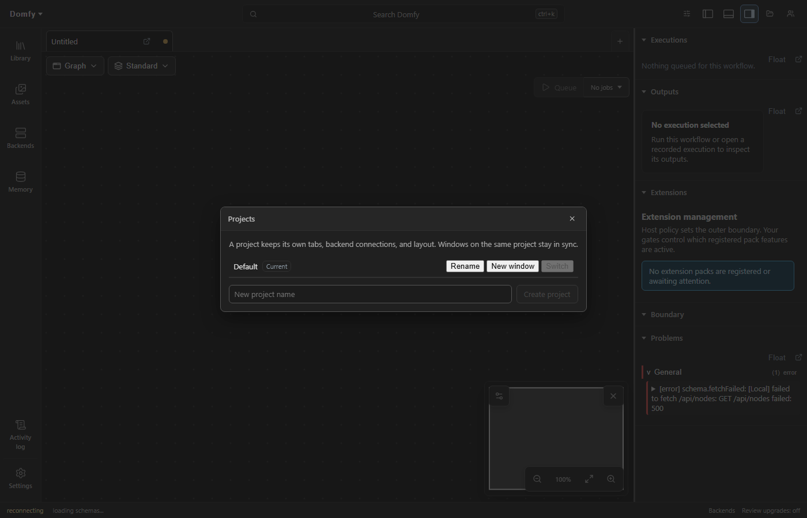
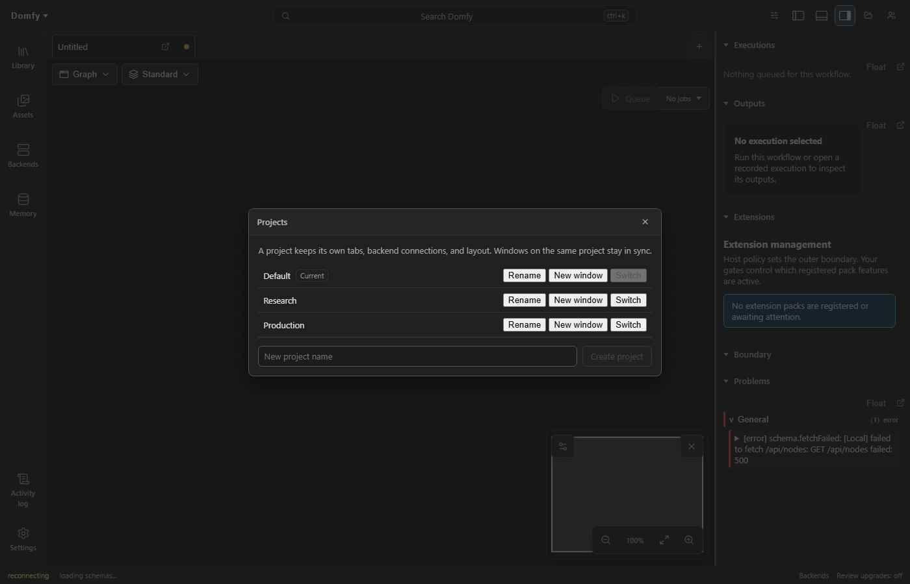
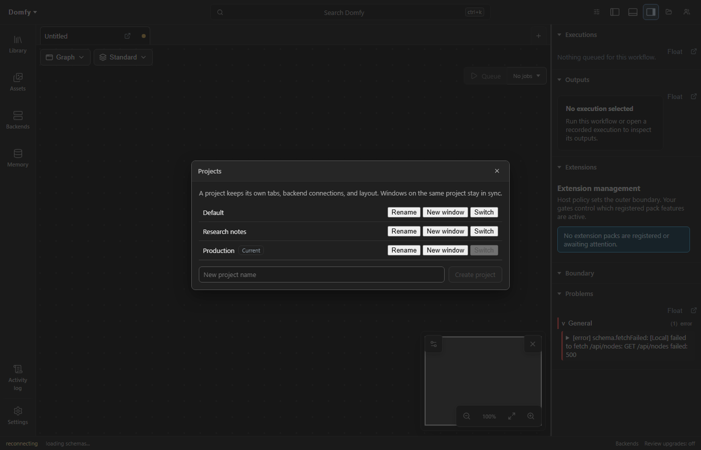

# Projects

A project is a named scope that binds together backend connections, open
documents, shell layout, and project-scoped settings. Each window belongs to
exactly one project; several windows may share one project and stay in sync,
while windows on different projects are fully isolated from each other.

## Using projects

Open **Projects** from the app toolbar (folder icon, workspace windows only)
to create, rename, or switch projects in the selected engine's library. The
list comes from the engine, including every page, rather than browser storage.
Every library starts with a **Default** project that carries pre-project state.
Loading and request failures are shown without substituting a local project list.

- **Create project** saves a new empty project in the engine library.
- **Rename** edits a project's display name in place (Enter commits, Escape
  cancels). The default project can be renamed too.
- **Switch** rebinds the current window to the chosen project. The window
  reloads into the target scope; other windows are unaffected.
- **New window** (desktop) opens an additional workspace window bound to the
  chosen project. In the browser it opens a new tab on that project.

Each project uses ProductListRow with a wrapping ProductActionFooter below its
name. ProductTextInput owns new names and rename drafts; ProductButton owns
actions and current-project disabling. Long names wrap instead of truncating.

## What is scoped per project

Per-project state: open workflow tabs and their drafts, the write-ahead
workspace operation journal, backend connections, collaboration session
memberships, shell layout (panel placement, rail visibility, region sizes),
and the shared workflow authority. Windows sharing a project converge on one
SharedWorker tab authority; each project gets its own worker, broadcast
channels, and web locks, so cross-project state can never bleed.

The engine library owns the shared project registry. Non-layout settings,
keybindings and desktop engine management remain independent of the window scope.
Renames use the record revision; a conflicting rename is reported and the list
is refreshed rather than overwriting another window's name.

## Identity and storage

On first successful connection, existing browser project descriptors are
registered with their stable IDs without a prompt. An existing engine record
wins a name collision. The original browser envelope is removed only after all
registrations acknowledge and the source is unchanged. Interrupted, failed or
unreadable migrations preserve it for recovery; reconnecting resumes registration.
Registration completes before requesting the project's node catalog. If registration
fails, the catalog stays unavailable rather than falling back to environment-wide
nodes. The catalog includes core nodes and packs used by the project's saved
workflows or explicitly enabled for that project.
No tabs, drafts, layout or other per-device state are removed. A response from a
retired connection cannot replace the current dialog list or retire migration data.

The default project keeps the legacy unprefixed storage keys and rendezvous
names, so existing user state becomes the default project with no migration.
Other projects prefix their storage keys with `dinkster.p.<id>.` and suffix
their SharedWorker, BroadcastChannel, and Web Lock names with the project id.
A window's project is carried in its URL (`dinksterProject`); workflow pop-outs
and panel windows inherit the opener's project so they join the same tab
authority.

## Needs and pack enablement

The client reads `/api/projects/{id}/needs` without cache or acquisition consent.
It preserves unknown workflow identities, versionless pack needs, and installed
pack versions separately from workflow requirements. Installed packs can be disabled
for a project; installed versions are not approval to update a shared environment.
Malformed responses fail instead of becoming an empty needs list. Project reads reject a
deleted project or an acknowledgment for a different ID. Persistent project UIDs
are retained separately from library-local IDs. Scoped installation reviews and
extra-pack enablement require that identity; a changed UID invalidates a retained
review even when its local ID, timestamp and revision match. Older read-only
project responses without a UID remain readable but cannot authorize enablement.

Extra-pack changes use the current project revision. A stale revision requires a
new read and review, not an automatic retry that could overwrite another window's
choices. This changes project enablement only; it does not install software or
change another project's packs.

On connection and workflow opening, one Project needs review combines saved project
requirements, extra packs, and used nodes in open workflows. Unused stamp entries
are ignored. Already-installed compatible packs can be enabled only in this
project. Missing or conflicting versions are listed separately as environment
changes, and unreadable workflows stay visible as unknown needs. This review does
not install or update software. It rechecks project revision and installed facts
before an enablement write; stale reviews require a new read. Transferring an
unchanged workflow into its shared editing session preserves the review; edits
or document replacements invalidate it. Successful enablement shows a dismissible
success toast and refreshes the scoped node catalog.

Review installation prepares an exact-version software review through the existing
host installation API. It does not apply the plan, enable packs, or run a workflow. The installation
client can send an explicit `every-project` or `only-project` scope during
preparation. Omitting scope preserves the non-project host contract; it does not
choose shared consent. Status and cancellation use only the preparation identity,
and Apply sends only the host-retained confirmation, never a replacement scope.
In a Desktop project window, the local engine review requires an explicit
Every project on it or Only this project choice, with no default. Changing the
choice discards the completed review and requires preparation again. An isolated
review describes a separate environment and does not list other projects as
changed; the shared review lists affected projects. Browser
and remote-engine reviews keep their terminal-only, unscoped contract.
Project needs preparation retains that requested scope alongside the completed
review and its remaining lifetime. Scope does not bypass the project, installed
pack, environment identity, snapshot or affected-project rechecks.
Unknown needs, unrecorded versions and conflicting versions require correction
before preparation. Project revision and installed facts are checked before and
after preparation; changed or dismissed reviews cannot publish a stale plan.
Closing a preparation cancels waiting through the existing preparation API. A
completed review expires after the host's stated interval. Preparation reads the
managed environment's stable ID and snapshot without browser caching and rechecks
both around the host review. A switch or snapshot change invalidates the result,
even if installed pack versions are unchanged. A project already associated with
another environment cannot prepare software against the running one. Reads retain
that association and its last-run metadata; they never reassign the project.
A selected environment with no run has both last snapshot and last-run time set
to null. It remains associated for review checks without claiming a run occurred;
a response with only one of these values is rejected as incomplete.
Standalone engines report no managed identity, rather than an engine assignment
name such as `main`.

The completed review names other projects whose recorded workflow needs or extra
packs intersect the retained plan's pack changes on this environment. Source
replacements and dependency changes count even when versions stay the same.
Projects on another environment are excluded. The project list is read without
browser caching, including every page, and both the list and the other projects'
needs are rechecked before presenting the result. Missing impact, unbound projects
or unreadable workflow needs are reported as unknown, not as an empty affected
list. Time spent collecting impact counts against the prepared review's lifetime;
a result that expires during those reads is not shown.

For a scoped native review with a retained confirmation, Confirm installation
applies that exact token once; scope cannot be replaced at confirmation. The
prompt blocks dismissal while applying. Browser and remote terminal-only reviews
do not offer this button. A lost or malformed Apply response blocks further
installation, including after closing and reopening the prompt; nothing retries
a possibly completed mutation automatically.

After acknowledged activation, the app waits up to 15 seconds for an expected
socket reconnection, without resending Apply. If the connection does not recover,
no packs are enabled and the prompt asks for reconnection and a new needs review.
The app then rechecks persistent project identity,
project/environment binding, the activated snapshot and exact selected pack
versions before enabling packs. Expected registry replacement does not invalidate
document ownership, but closing, editing or replacing the reviewed document does.
The extra-pack write preserves the latest choices from other windows and uses the
latest project revision as a compare-and-swap guard. Changed identity, unknown
needs, version mismatches or revision conflicts leave extra packs untouched and
require another needs review. Successful enablement refreshes the scoped catalog
and shows a success toast; no workflow runs automatically.

## Desktop windows

The desktop shell persists every workspace window with its project binding,
plus each project-associated workflow and panel window, and restores the full
arrangement at startup. Closing the primary window still quits; additional
workspace windows close independently. The same workflow may be torn out once
per project. Switching a workspace window's project reloads only that window;
tear-outs keep their own project binding and keep working.
